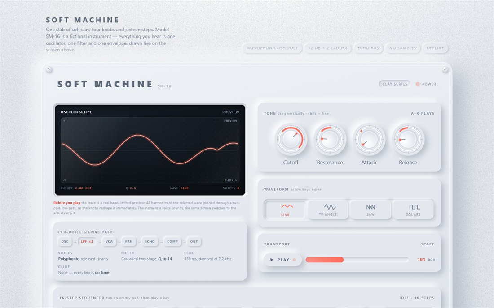
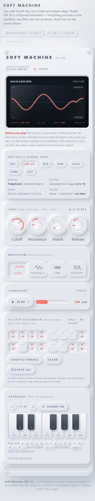

# SOFT MACHINE · SM-16

**中文** ｜ [English](#english)

> **一块软陶，四个旋钮，十六步。**
> 一个可以真的弹响的 neumorphic 合成器，全部塞进一个 HTML 文件。

**[▶ 在线试玩](https://daoge96.github.io/soft-machine/)**　·　或直接下载 [`007-neumorphic-synth.html`](007-neumorphic-synth.html) 双击打开（离线可用）



---

## 这是什么

一台虚构型号 **SM-16** 的软件合成器。整台琴从同一块软陶页面（`#e4e8ee`）里雕塑出来——凸起的旋钮、凹进的屏幕、按下才亮的软垫、四角带旋转槽的螺丝、随输出电平呼吸的电源灯。全页只有**一种**彩色，珊瑚红 `#ff6b5a`，只用在会发光的地方。

声音不是采样，是**现场算出来**的：纯 Web Audio，手写信号链。打开就能弹，不联网、不加载任何外部资源。

## 它是怎么响的

```
振荡器 → 低通 ×2（24 dB/oct，共振在第一级，带短促 pluck）
      → 音量包络（attack / release）
      → 声像 → 回声总线（330 ms，2.2 kHz 阻尼）
      → 压缩 → 输出
```

复音上限 16 声部。超过时最老的声部被**接管**——振荡器不重建，只改音高、重排包络，所以先按的音不会突然变哑。松手后节点在 release 结束时拆掉，不留尾巴。

## 屏幕：先预告，再直播

左上角那块 OLED 风格的凹陷屏幕是整台琴的门面：

- **你没弹的时候**，它不是摆设图，而是一段**真的带限预览**——把选定波形的 48 次谐波乘上双极点低通的解析响应（幅值平方、相位加倍，与真实信号链一致）。所以你拧截止频率或共振，波形会**当场改变形状**，共振会真的"起铃"。
- **按下第一个键**，屏幕无缝切到 `AnalyserNode` 的真实输出：找上升过零点做触发对齐，波形稳稳站着不左右乱跑；珊瑚色描边分三遍叠加出辉光；徽标从 `preview` 翻成 `live output`。
- 静音时它**如实变平**（拾音点在静音增益之后，画的就是你听到的），但继续刷新不黑屏。

## 怎么玩

| 操作 | 做什么 |
| --- | --- |
| `A W S E D F T G Y H U J K`（`O L P ;` 往上延伸） | 弹奏 |
| `Tab` 进键盘后 `←` `→` `Home` `End` | 逐键走音并试听（整个键盘是**一个** tab stop） |
| 鼠标/触摸在琴键上横向滑动 | 滑音 glissando |
| `Z` / `X` 或 `−` / `+` | 整键盘移八度 |
| 拖四个旋钮（`Shift` 微调、滚轮、方向键、双击复位） | 截止 120 Hz–11 kHz、共振 0.1–14、起音 1–900 ms、释音 30–2600 ms |
| 波形四分段按钮（方向键切换） | 正弦 / 三角 / 锯齿 / 方波，正在响的音立刻换音色 |
| 空格 | 播放 / 停止音序器（60–180 BPM） |
| 点一个空软垫，再弹任意键 | 把那个音录进这一步；虚线环表示"在听" |
| Shuffle / Clear | 生成新的一句 A 小调五声音阶，或清空 |
| 喇叭按钮 | 淡出静音 / 恢复 |

音色、静音、速度、八度、Pattern 都记在本地（`localStorage`），下次打开还在。



## 工程细节

- 语义化 HTML5、唯一 id、控件都有 `aria-label`/`aria-valuetext`；旋钮是 `role="slider"` 且带完整取值三元组；波形是真正的 `radiogroup`；琴键暴露 `aria-pressed`。
- `:focus-visible` 焦点环在陶土底色上清晰可见；播放头、状态、提示走 `aria-live`。
- 标签页切走时停止音序器并释放按住的音；画布按容器 × `devicePixelRatio`（上限 2）重建；动画全部走 `requestAnimationFrame` 与 transform/opacity；跟随 `prefers-reduced-motion`。
- 响应式 360 px → 宽屏：手机上屏幕叠到旋钮上方、音序器折成 8×2、键盘重建成一个紧凑八度，**任何宽度都不横向滚动**。

| | |
| --- | --- |
| 文件 | 1 个 HTML，约 90 KB，1900+ 行 |
| 依赖 | **无**，0 个外部请求 |
| 音频 | 纯 Web Audio |
| 视觉 | CSS / 内联 SVG / Canvas，无位图 |
| 字体 | 仅系统字体栈，末端为通用族 |
| 状态 | `localStorage`（`try/catch` 包裹） |

## 验证

用真实 Chrome 通过 CDP 驱动，**327 条断言，0 失败**：HTML/离线契约、首帧、全部控件、音频信号、音序器、静音、持久化（含被禁用的 storage）、reduced-motion、11 档视口无溢出、a11y 清单，以及压力项（20 音复音、3000 音爆发、声部上限与接管、速度极值、边移八度边演奏、DPR 3、320→2560 px、焦点顺序、引擎重建）。

另经一轮独立对抗性审计，发现并修掉 1 个 blocker、若干 major（含"复用的被偷声部带着旧 release 的 `stop()` 时间而永久静音"、"八度切换漏重映射按下状态"）后才定稿。全程 0 异常、0 控制台错误、0 警告、0 外部请求。

## 顺带一说

SM-16 是**虚构型号**，页面文案、参数与那句 "clay series" 都是它自己的设定——但所有数字都对应真实存在的信号链，没有一个是为了好看编的。

---

## English

**中文 ↑** ｜ **English**

> **One slab of soft clay, four knobs, sixteen steps.**
> A playable neumorphic synthesizer in a single HTML file.

**[▶ Play it live](https://daoge96.github.io/soft-machine/)**　·　or grab [`007-neumorphic-synth.html`](007-neumorphic-synth.html) and open it — works offline.

### What it is

A software synthesizer for a fictional model, the **SM-16**. The whole instrument is sculpted out of one slab of soft clay (`#e4e8ee`): raised knobs, an inset screen, pads that only light when pressed, corner screws with turned slots, a power LED breathing with the output level. There is exactly **one** colour on the page — warm coral `#ff6b5a` — and it is used only where something glows.

Nothing is sampled. Every voice is computed live in hand-written Web Audio. Open and play: no network, no external resources of any kind.

### Signal path

```
oscillator → low-pass ×2 (24 dB/oct, resonance on the first stage, with a filter pluck)
           → attack/release envelope
           → pan → echo bus (330 ms, damped at 2.2 kHz)
           → compressor → out
```

16-voice polyphony. Past the limit the oldest voice is **adopted** rather than rebuilt — retuned and re-enveloped, so an earlier note never just drops out. Nodes are torn down when a release finishes.

### The screen: preview, then live

The inset OLED-style scope is the instrument's face:

- **Before you play**, it is not decoration — it is a real band-limited preview: 48 harmonics of the selected wave multiplied by the analytic response of a two-pole low-pass (magnitude squared, phase doubled, matching the real chain). Turning cutoff or resonance reshapes it immediately, and resonance genuinely rings.
- **The moment you play**, it hands over to the real `AnalyserNode` output: zero-crossing triggered so the trace stands still, a three-pass coral stroke for the glow, and a badge that flips `preview` → `live output`.
- While muted it honestly flatlines (the tap sits after the mute gain) but keeps refreshing.

### Controls

| Input | Does |
| --- | --- |
| `A W S E D F T G Y H U J K` (`O L P ;` extends) | play |
| `Tab` into the keyboard, then `←` `→` `Home` `End` | walk and audition keys (the keyboard is **one** tab stop) |
| slide across the keys | glissando |
| `Z` / `X` or `−` / `+` | shift the whole keyboard an octave |
| drag the four knobs (`Shift` fine, wheel, arrows, double-click reset) | cutoff 120 Hz–11 kHz, resonance 0.1–14, attack 1–900 ms, release 30–2600 ms |
| the four-way selector (arrow keys) | sine / triangle / saw / square, retuning sounding voices instantly |
| `Space` | play / stop the sequencer (60–180 BPM) |
| tap an empty pad, then play a key | record that note into the step |
| Shuffle / Clear | write a new A-minor-pentatonic phrase, or empty it |
| the speaker | fade mute / unmute |

Patch, mute, tempo, octave and pattern persist in `localStorage`.

### Engineering

- Semantic HTML5, unique ids, `aria-label`/`aria-valuetext` on every control; knobs are `role="slider"` with full value triplets; the selector is a real `radiogroup`; keys expose `aria-pressed`.
- Visible `:focus-visible` rings on clay; `aria-live` for transport state and toasts.
- Sequencer stops and held notes release when the tab is hidden; the canvas rebuilds at container × `devicePixelRatio` (capped at 2); all motion via `requestAnimationFrame` and transform/opacity; honours `prefers-reduced-motion`.
- Responsive 360 px → wide: on phones the screen stacks above the knobs, the sequencer folds 8×2 and the keyboard rebuilds as one compact octave — no horizontal scroll at any width.

| | |
| --- | --- |
| Footprint | 1 HTML file, ~90 KB, 1900+ lines |
| Dependencies | **none**, 0 external requests |
| Audio | pure Web Audio |
| Visuals | CSS / inline SVG / Canvas, no bitmaps |
| Type | system font stacks only, ending in a generic |
| State | `localStorage`, guarded with `try/catch` |

### Verification

Driven through real Chrome over CDP: **327 assertions, 0 failures** — offline contract, first frame, every control, audio signal, sequencer, mute, persistence (including disabled storage), reduced motion, 11 viewport widths without overflow, an a11y scorecard, plus stress (20-voice polyphony, 3000-note burst, voice cap and adoption, tempo extremes, octave-shift while playing, DPR 3, 320→2560 px, focus order, engine rebuild).

A separate adversarial audit round found and closed one blocker and several majors — including an adopted stolen voice keeping the old release's `stop()` time and going permanently silent, and an octave shift failing to remap pressed-key state — before this was considered done. No exceptions, console errors, warnings or external requests throughout.

### Note

The SM-16 is a **fictional model**; the panel copy, specs and the "clay series" line are its own fiction — but every number maps to a signal chain that actually exists. Nothing was invented to look good.

---

### Repo layout

```
index.html                    the instrument (GitHub Pages entry)
007-neumorphic-synth.html     identical copy, collection filename
INTRO.md                      longer write-up (中文 + English)
screenshots/                  desktop + phone
```

Licence: MIT. Model and copy are fiction; the audio is real.
